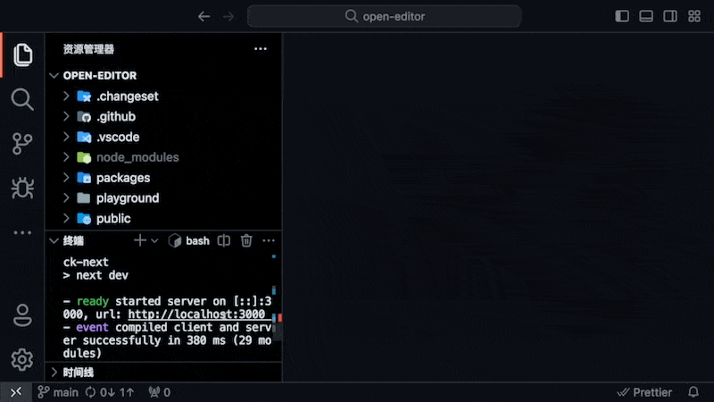
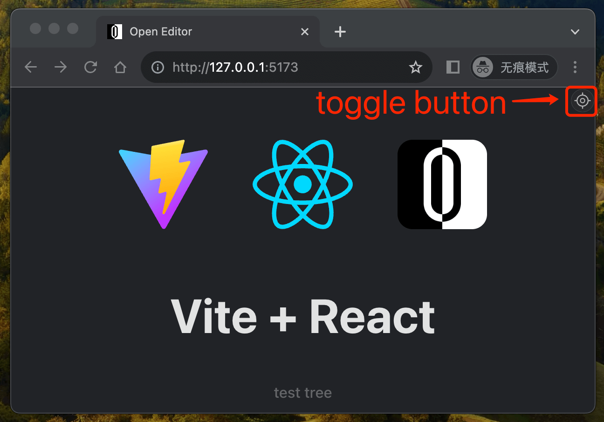
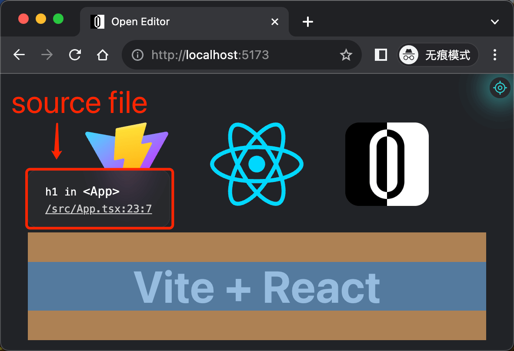
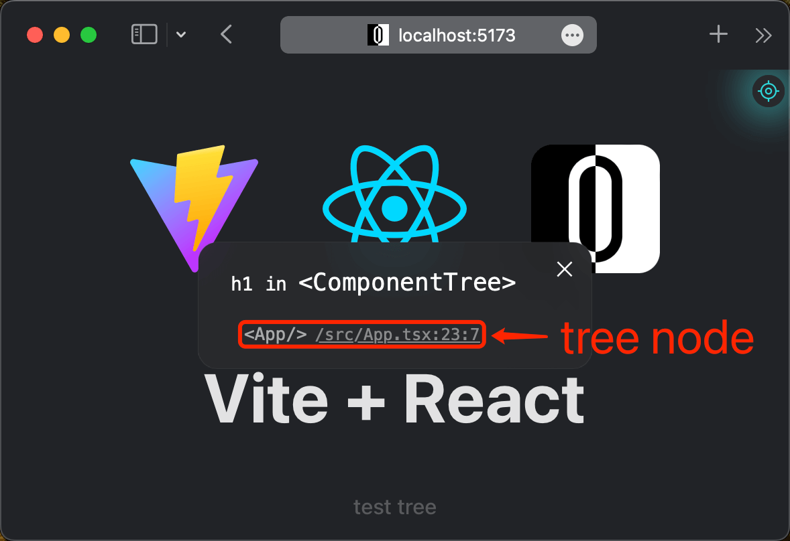

<p align="center">
  <a href="https://github.com/zjxxxxxxxxx/open-editor">
      
      <h1 align="center">Open Editor</h1>
  </a>
</p>
</br>
<p align="center">
  <a href="https://github.com/zjxxxxxxxxx/open-editor/actions/workflows/ci.yml">
    
  </a>
  
  </a>
</p>
<p align="center">
  <a href="./README.md">English</a> | <a href="./README.zh-CN.md">简体中文</a>
</p>
</br>

## 🔍 Project Overview

`OpenEditor` is a front-end debugging tool specifically designed for modern web development. By deeply integrating with build toolchains, it achieves precise two-way mapping between browser elements and source code. This solution not only enables developers to directly locate source code positions within React/Vue component trees, but also automatically launches local IDEs to open corresponding files. This innovative approach helps developers save over 90% of source code navigation time, significantly improving debugging efficiency.

[▶▶▶ Live Demo (Vite+React Example)](https://stackblitz.com/github/zjxxxxxxxxx/open-editor/tree/main/playgrounds/vite-react19?embed=1&file=vite.config.ts&hideExplorer=1)  
[](https://stackblitz.com/github/zjxxxxxxxxx/open-editor/tree/main/playgrounds/vite-react19?embed=1&file=vite.config.ts&hideExplorer=1)

## 🚀 Core Features

### Framework Support

- **React Ecosystem**: Deep integration with modern scaffolds like Create React App/Next.js
- **Vue Ecosystem**: Full support for development solutions like Vue CLI/Nuxt.js/Vite
- **Build Tools**: Full compatibility with Webpack 4+/Vite 2+/Rollup 2+ systems

### Integration Capabilities

- 🚫 Zero‑intrusion design (no need to import an SDK or add any configuration on the project side)

### Debugging Capabilities

- 🕵️ Multi-level component tree tracing (Supports cross-iframe communication scenarios)
- ⌨️ Hotkey-driven workflow (⌥⌘O to launch debugger, ESC to exit inspection mode)
- 📱 Mobile remote debugging (Requires same LAN as desktop)
- 🔍 Intelligent IDE detection (Auto-recognizes local IDEs like VS Code/WebStorm)

### Environment Support

- **Exclusive Mode**: Development environment-only features (Auto-disabled in production)
- **Runtime Requirements**:
  - Node.js 14+ runtime (LTS version recommended)
  - Modern browser requirements (Latest stable version of any):
    - Google Chrome ≥ 89 (Released 03/2021)
    - Mozilla Firefox ≥ 85 (Released 01/2021)
    - Microsoft Edge ≥ 90 (Released 04/2021)
    - Apple Safari ≥ 14 (Released 09/2020)

## 🛠️ Quick Start

### Prerequisites

#### React Projects

Install and use the necessary dependency [@open-editor/react](./packages/react/README.md), which is a plugin used to inject source code location information into `React Element`

```bash
npm i @open-editor/react -D
```

#### Vue Projects

Install and use the necessary dependency [@open-editor/vue](./packages/vue/README.md), which is a plugin used to inject source code location information into `Vue VNode`

```bash
npm i @open-editor/vue -D
```

### Integration Example

> Demonstrated with `Vite+React` ([source](https://github.com/zjxxxxxxxxx/open-editor/tree/main/playgrounds/vite-react19)). Configuration varies by tech stack, but core logic remains consistent.

#### Tool Integration

##### 1. Install Plugin

```bash
npm i @open-editor/vite @open-editor/react -D
```

##### 2. Add Configuration

```ts
// vite.config.ts
import { defineConfig } from 'vite';
import react from '@vitejs/plugin-react';
import openEditorReact from '@open-editor/react/vite';
import openEditor from '@open-editor/vite';

export default defineConfig({
  plugins: [
    openEditorReact(),
    react(),
    openEditor({
      // options
    }),
  ],
});
```

##### 3. Start Dev Server

```bash
npm run dev
```

#### Debugging Workflow

##### 1. Activate Inspector

- Keyboard shortcuts:
  - macOS: Option + Command + O
  - Windows: Alt + Ctrl + O
- Mouse operation:
  - Click toggle button in browser toolbar

###### Toggle Button Example



##### 2. Element Inspection

- Hover preview:
  - Mouse hover displays source location (with file/line/column info)
- Precise positioning:
  - Click element to jump directly in editor (auto line/column positioning)
  - Deep inspection mode:
    - macOS: Command + Click element to expand component tree
    - Windows: Ctrl + Click element to expand component tree
    - Long press element (300ms) to expand component tree

###### Hover Preview Demo



###### Component Tree Preview



##### 3. Exit Inspector

- Keyboard shortcuts:
  - Universal: Esc
  - macOS: Press again Option + Command + O
  - Windows: Press again Alt + Ctrl + O
- Mouse operations:
  - Click toggle button to close inspection mode
  - Right-click blank area of the page

## ⚙️ Advanced Features

### Global Events

```ts
// Custom inspector activation
window.addEventListener('enableinspector', (e) => {
  e.preventDefault(); // Block default behavior
});

// Custom inspector exit
window.addEventListener('exitinspector', (e) => {
  e.preventDefault(); // Block default behavior
});

// Custom editor launch
window.addEventListener('openeditor', (e) => {
  const url = e.detail;
  url.hostname = 'localhost'; // Modify domain
  fetch(url);
  e.preventDefault(); // Block default behavior
});
```

## 🖼 Ecosystem

### Official Plugins

| Documentation                                                                                   | NPM Version                                                                                                                    | Downloads                                                                                                                    |
| ----------------------------------------------------------------------------------------------- | ------------------------------------------------------------------------------------------------------------------------------ | ---------------------------------------------------------------------------------------------------------------------------- |
| [`@open-editor/rollup`](https://github.com/zjxxxxxxxxx/open-editor/tree/main/packages/rollup)   | [](https://www.npmjs.com/package/@open-editor/rollup)   | [](https://www.npmjs.com/package/@open-editor/rollup)   |
| [`@open-editor/vite`](https://github.com/zjxxxxxxxxx/open-editor/tree/main/packages/vite)       | [](https://www.npmjs.com/package/@open-editor/vite)       | [](https://www.npmjs.com/package/@open-editor/vite)       |
| [`@open-editor/webpack`](https://github.com/zjxxxxxxxxx/open-editor/tree/main/packages/webpack) | [](https://www.npmjs.com/package/@open-editor/webpack) | [](https://www.npmjs.com/package/@open-editor/webpack) |
| [`@open-editor/react`](https://github.com/zjxxxxxxxxx/open-editor/tree/main/packages/react)     | [](https://www.npmjs.com/package/@open-editor/react)     | [](https://www.npmjs.com/package/@open-editor/react)     |
| [`@open-editor/vue`](https://github.com/zjxxxxxxxxx/open-editor/tree/main/packages/vue)         | [](https://www.npmjs.com/package/@open-editor/vue)         | [](https://www.npmjs.com/package/@open-editor/vue)         |

### Online Playgrounds

| Source Code                                                                                         | Live Demo                                                                                                                                                                         |
| --------------------------------------------------------------------------------------------------- | --------------------------------------------------------------------------------------------------------------------------------------------------------------------------------- |
| [`rollup/react15`](https://github.com/zjxxxxxxxxx/open-editor/tree/main/playgrounds/rollup-react15) | [](https://stackblitz.com/github/zjxxxxxxxxx/open-editor/tree/main/playgrounds/rollup-react15)  |
| [`rollup/vue2`](https://github.com/zjxxxxxxxxx/open-editor/tree/main/playgrounds/rollup-vue2)       | [](https://stackblitz.com/github/zjxxxxxxxxx/open-editor/tree/main/playgrounds/rollup-vue2)     |
| [`vite/react`](https://github.com/zjxxxxxxxxx/open-editor/tree/main/playgrounds/vite-react19)       | [](https://stackblitz.com/github/zjxxxxxxxxx/open-editor/tree/main/playgrounds/vite-react19)    |
| [`vite/vue`](https://github.com/zjxxxxxxxxx/open-editor/tree/main/playgrounds/vite-vue3)            | [](https://stackblitz.com/github/zjxxxxxxxxx/open-editor/tree/main/playgrounds/vite-vue3)       |
| [`vite/nuxt`](https://github.com/zjxxxxxxxxx/open-editor/tree/main/playgrounds/vite-nuxt3)          | [](https://stackblitz.com/github/zjxxxxxxxxx/open-editor/tree/main/playgrounds/vite-nuxt3)      |
| [`webpack/react`](https://github.com/zjxxxxxxxxx/open-editor/tree/main/playgrounds/webpack-react18) | [](https://stackblitz.com/github/zjxxxxxxxxx/open-editor/tree/main/playgrounds/webpack-react18) |
| [`webpack/nextjs`](https://github.com/zjxxxxxxxxx/open-editor/tree/main/playgrounds/webpack-next15) | [](https://stackblitz.com/github/zjxxxxxxxxx/open-editor/tree/main/playgrounds/webpack-next15)  |
| [`webpack/vue`](https://github.com/zjxxxxxxxxx/open-editor/tree/main/playgrounds/webpack-vue3)      | [](https://stackblitz.com/github/zjxxxxxxxxx/open-editor/tree/main/playgrounds/webpack-vue3)    |

## Special Thanks

This project is inspired and aided by the following outstanding open-source projects:

- [react-dev-inspector](https://github.com/zthxxx/react-dev-inspector) - Indispensable tool for React component debugging
- [vite-plugin-vue-inspector](https://github.com/webfansplz/vite-plugin-vue-inspector) - Vue component debugging solution
- [launch-editor](https://github.com/yyx990803/launch-editor) - Core implementation for editor quick location
